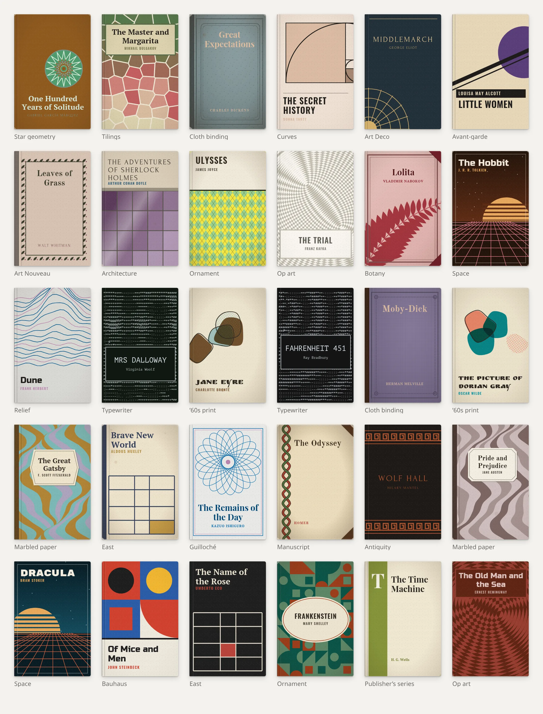

# knigopis-pereplet

**English** · [Русский](README.ru.md)

Generative book covers from a title and an author: SVG with no images and no network requests. Made for
[Knigopis](https://www.knigopis.com), fits any list of books.



*Each cover is labelled with its style. Everything above was drawn from the title and the author alone.*

- **24 styles, 82 variants**: bindings (cloth, leather, marbled paper), publisher's series, eras and countries
  (avant-garde, Bauhaus, Art Deco, Art Nouveau, antiquity, manuscripts, the East…), mathematics (guilloché, Penrose,
  Voronoi, Truchet, Hilbert and dragon curves, relief), architecture and botany.
- **Binding details combine freely**: a spine strip, leather corners, six kinds of frames, six label shapes,
  rules and emblems. Styles use them only where they fit: a frame for a fern or a contour map, a spine and corners
  for marbled and patterned paper.
- **Colours**: where paints mix freely, they come from Sanzo Wada's 348 combinations
  ("A Dictionary of Color Combinations", 1933) or from close shades of one paint; styles with their own history
  (avant-garde, Art Deco, manuscripts…) keep their own palettes.
- **The title comes first**: patterns stay clear of the text or sit under a label; covers stay readable at 80 px.
- **One series per author**: the surname picks the style, so "Bulgakov", "M. A. Bulgakov" and "Mikhail Bulgakov"
  look alike. The variant, colours, pattern scale, font, binding details and wear depend on the title.
- **Same everywhere**: text is laid out from glyph width tables rather than canvas, so the result does not depend on
  the browser and works in Node. The same book gets the same cover within a major version.
- **Small**: ~26 KB of JS (gzip, palettes included), ~0.2 ms per cover, usually 3–12 KB of SVG. Fonts (9 of them,
  111 KB in total, Latin and Cyrillic) load one by one — only those used by covers on screen.

## Usage

```sh
npm i knigopis-pereplet
```

```js
import { drawCover } from 'knigopis-pereplet';
import 'knigopis-pereplet/fonts.css'; // @font-face rules for the cover fonts

const cover = drawCover({ title: 'The Master and Margarita', author: 'Mikhail Bulgakov' });
await Promise.all(cover.fonts.map((f) => document.fonts.load(f))); // fonts this cover needs
el.innerHTML = cover.svg; // inline it: an  cannot see the page's fonts
```

`drawCover(book, options?)` → `{ svg, style, variant, fonts }`:

| option | meaning |
|---|---|
| `style` | style id instead of the one picked by the author (see `STYLES`) |
| `variant` | variant number within the style |
| `age` | wear, 0…1 |
| `id` | prefix for ids inside the SVG (defaults to one derived from the title: identical covers share identical ids, which is safe) |

The SVG has `viewBox="0 0 200 300"` (2:3); the container sets the size, as well as any shadow, rounding or backdrop.

## Development

```sh
npm test               # every style and variant, edge cases, cover snapshot
UPDATE=1 npm test      # refresh the snapshot — only on purpose: it changes everyone's covers (major version)
npm run size           # bundle: at most 30 KB gzip
npm run gallery        # gallery/out/ — a gallery of all variants (open preview.html locally)
node scripts/dev.mjs   # bundle for gallery/dev.html (?style=cloth,marble&n=10&big=1)
node scripts/readme.mjs  # README images (docs/covers-*.webp); needs Chrome and ImageMagick
npm run fonts -- <dir with TTF>  # fonts: subset → fonts/, width table → src/metrics.ts
node scripts/wada.mjs  # Wada palettes → src/wada.ts (from the dictionary-of-colour-combinations package)
scripts/publish.sh [2FA code]  # publish to npm (token in ~/.config/npm-token; checks run in prepublishOnly)
```

Layout: `src/index.ts` picks the style and runs the pipeline; `src/cover.ts` has textures, binding details, wear and
text layout; `src/text.ts` — widths, line breaking, size fitting; `src/styles/*` — the styles. A style gets the text
area (`L`, `R`, `cx`, `cw`, already minus the spine strip) and returns the SVG, texture, how much it may age and its
binding details: strip material, corners, frame. The pipeline adds the strip with the style's probability `sp`;
labels, frames and corner ornaments come from `lab()`, `box()`, `orns()`. Palettes: `wada()` — a Wada combination,
`shades()` — close shades of one paint, `palette()` — either.

## Fonts

From [google/fonts](https://github.com/google/fonts), SIL OFL 1.1: PT Serif, Old Standard TT, Playfair Display,
Forum, Oswald, Russo One, Rubik Mono One, Ruslan Display, PT Mono. Subset to Latin, Cyrillic and punctuation;
no hinting and no OpenType features (the width tables ignore kerning).

## Palettes

Sanzo Wada (1883–1967), "A Dictionary of Color Combinations", via the
[dictionary-of-colour-combinations](https://github.com/mattdesl/dictionary-of-colour-combinations) dataset
(MIT, Matt DesLauriers; data collected by Dain M. Blodorn Kim). `src/wada.ts` holds 159 colours and 348 combinations, ~2 KB gzip.

## License

MIT; fonts are OFL (`fonts/*-OFL.txt`).
