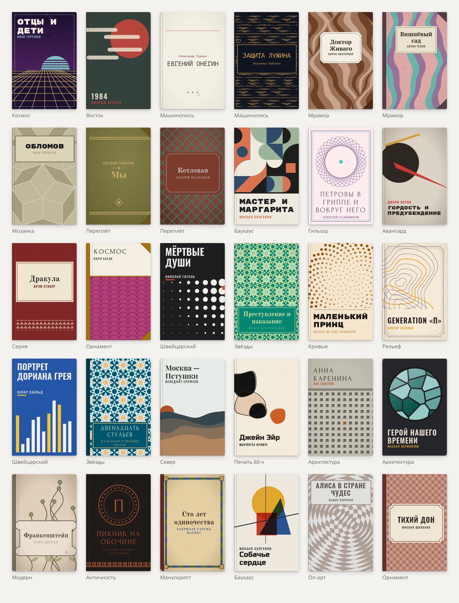

# knigopis-pereplet

[English](README.md) · **Русский**

Обложки книг из названия и автора: SVG без картинок и запросов. Сделано для
[Книгописи](https://www.knigopis.com), подходит любому списку книг.



*Под каждой обложкой — её стиль. Все обложки выше нарисованы из одних названий и авторов.*

- **24 стиля, 82 варианта**: переплёты (ткань, кожа, мрамор), издательские серии, эпохи и страны
  (авангард, Баухаус, ар-деко, модерн, античность, манускрипт, Восток…), математика (гильош, Пенроуз,
  Вороной, Трюше, кривые Гильберта и дракона, рельеф), архитектура и ботаника.
- **Оформление переплёта** сочетается свободно: полоса корешка, уголки, рамки шести видов, наклейки шести форм,
  линейки, эмблемы. Стили берут его там, где оно к месту: рамку — к папоротнику и карте рельефа, корешок и уголки —
  к мрамору и узорной бумаге.
- **Цвета** там, где краски сочетаются свободно, — из 348 сочетаний Вады Сандзо
  («A Dictionary of Color Combinations», 1933) или близкие оттенки одной краски; у стилей со своей историей
  (авангард, ар-деко, манускрипт…) — свои.
- **Название главнее рисунка**: узор держится в стороне от текста или уходит под плашку; обложка читается и в 80 px.
- **Серия по автору**: стиль выбирает фамилия — «Булгаков», «М. А. Булгаков» и «Михаил Булгаков» дают одно и то же.
  Вариант, краски, масштаб узора, шрифт, оформление и потёртости — от названия.
- **Одинаково везде**: текст раскладывается по таблицам ширин знаков, а не по canvas, поэтому результат
  не зависит от браузера и работает в Node. Одна и та же книга — одна и та же обложка в пределах мажорной версии.
- **Лёгкий**: ~26 КБ JS (gzip, с палитрами), ~0,2 мс на обложку, обычно 3–12 КБ SVG. Шрифты (9 штук, 111 КБ всего,
  латиница и кириллица) грузятся по одному — только те, что попали на экран.

## Использование

```sh
npm i knigopis-pereplet
```

```js
import { drawCover } from 'knigopis-pereplet';
import 'knigopis-pereplet/fonts.css'; // @font-face для шрифтов обложек

const cover = drawCover({ title: 'Мастер и Маргарита', author: 'Михаил Булгаков' });
await Promise.all(cover.fonts.map((f) => document.fonts.load(f))); // шрифты этой обложки
el.innerHTML = cover.svg; // встраивать в страницу:  не видит шрифтов страницы
```

`drawCover(book, options?)` → `{ svg, style, variant, fonts }`:

| опция | что |
|---|---|
| `style` | id стиля вместо выбранного по автору (`STYLES` — список) |
| `variant` | номер варианта стиля |
| `age` | потёртость 0…1 |
| `id` | приставка id внутри SVG (по умолчанию от названия: одинаковые обложки делят одинаковые id — это безопасно) |

SVG — `viewBox="0 0 200 300"` (2:3), размер задаёт контейнер. Тень, скругление и подложку — тоже он.

## Разработка

```sh
npm test               # все стили и варианты, крайние случаи, снимок обложек
UPDATE=1 npm test      # обновить снимок — только намеренно, это меняет обложки у всех (мажорная версия)
npm run size           # бандл: не больше 30 КБ gzip
npm run gallery        # gallery/out/ — галерея всех вариантов (preview.html — открыть локально)
node scripts/dev.mjs   # сборка для gallery/dev.html (?style=cloth,marble&n=10&big=1)
node scripts/readme.mjs  # картинки для README (docs/covers-*.webp); нужны Chrome и ImageMagick
npm run fonts -- <папка с TTF>  # шрифты: подмножество → fonts/, таблица ширин → src/metrics.ts
node scripts/wada.mjs  # палитры Вады → src/wada.ts (из пакета dictionary-of-colour-combinations)
scripts/publish.sh [код 2FA]  # выпуск в npm (токен — ~/.config/npm-token, проверки — prepublishOnly)
```

Устройство: `src/index.ts` — выбор стиля и конвейер; `src/cover.ts` — фактуры, оформление переплёта, потёртости, раскладка
текста; `src/text.ts` — ширины, перенос, подбор кегля; `src/styles/*` — стили. Стиль получает место под текст
(`L`, `R`, `cx`, `cw`, уже за вычетом полосы корешка) и возвращает SVG, фактуру, меру старения и оформление:
материал полосы, уголки, рамку. Полосу выдаёт конвейер с долей `sp` стиля; наклейки, рамки и украшения углов — `lab()`,
`box()`, `orns()`. Палитры: `wada()` — сочетание Вады, `shades()` — близкие оттенки одной краски, `palette()` — то или другое.

## Шрифты

Из [google/fonts](https://github.com/google/fonts), SIL OFL 1.1: PT Serif, Old Standard TT, Playfair Display,
Forum, Oswald, Russo One, Rubik Mono One, Ruslan Display, PT Mono. Подмножество — латиница, кириллица, знаки;
без хинтинга и OpenType-фич (кернинг таблицы ширин не учитывают).

## Палитры

Вада Сандзо (1883–1967), «A Dictionary of Color Combinations» — по набору
[dictionary-of-colour-combinations](https://github.com/mattdesl/dictionary-of-colour-combinations)
(MIT, Matt DesLauriers; данные собрал Dain M. Blodorn Kim). В `src/wada.ts` — 159 цветов и 348 сочетаний, ~2 КБ gzip.

## Лицензия

MIT; шрифты — OFL (`fonts/*-OFL.txt`).
